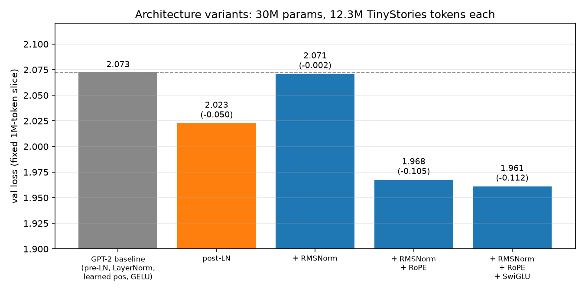

# Experiments (Milestone 5)

All runs: TinyStories, GPT-2 tokenizer, 1,500 steps × 8,192 tokens = **12.3M tokens**, same seed, data order,
and LR schedule (warmup 100 → cosine to 1e-4). Baseline = GPT-2 style, 6 layers × 384 wide (30M params).
Final numbers are from the fixed eval harness (`python -m toy_gpt2.eval`: the same 1M val tokens for every model),
so differences of ~0.005 or more are real rather than sampling noise. Baseline: **2.073** (0.729 bits/byte).
Predictions were written down **before** seeing results.

## A. Model size vs loss ✅

| Model | Non-emb params | Val (fixed slice) | Bits/byte | Tokens / param |
|---|---|---|---|---|
| 2L × 128 | 0.40M | 2.749 | 0.967 | 31 |
| 4L × 256 | 3.16M | 2.244 | 0.789 | 3.9 |
| 6L × 384 | 10.65M | 2.073 | 0.729 | 1.2 |

**Takeaway:** loss falls roughly linearly in log(params), but with shrinking returns at a fixed token budget
(~0.56 per 10× → ~0.32 per 10×). The big model is data-starved (1.2 tokens/param vs Chinchilla's ~20).
Same model with 3.3× more tokens (the 41M-token run) reached **1.674**, a gain of 0.41, versus 0.17 from 3.4× more params.

## B. Pre-LN vs post-LN ✅

**Prediction:** no meaningful change at 6 layers. Pre-LN's clean residual path (guards against vanishing gradients)
should matter more as depth grows.

| Variant | Val (fixed slice) | Δ vs baseline | Median tok/s |
|---|---|---|---|
| pre-LN (baseline) | 2.073 | — | 7.2k |
| post-LN | **2.023** | **−0.050** | 7.6k |

**Result vs prediction:** ❌ predicted no change; post-LN was **better** by 0.05. It started slower (3.27 vs 3.17 at step 250)
and overtook by step 500.

**Takeaway (William):**
I was surprised by this one because I assumed pre-LN would be the same or better since modern models have switched to it since 2017 transformer.
However, with the small size of our model, post-LN outperformed. pre-LN is better at larger scale models to keep the residual stream in tact and combat vanishing gradients. but post-LN outperforms with the scale of our model due to more holistic normalisation.

## C. Modern upgrades, cumulative ✅

**Predictions:**
- **RMSNorm:** no change in loss; maybe slightly faster.
- **RoPE:** learned positions may win at this scale (256 positions, all well trained); expect a tipping point
  in RoPE's favour at larger scale / longer context. Maybe slightly faster (no position table).
- **SwiGLU:** a very small improvement (gating gives finer control than GELU).

| Variant | Val (fixed slice) | Δ vs previous | Median tok/s | Prediction |
|---|---|---|---|---|
| GPT-2 baseline | 2.073 | — | 7.2k | |
| + RMSNorm | 2.071 | −0.002 | 6.8k* | ✅ no loss change · speed: no real difference (see note) |
| + RoPE | **1.968** | **−0.103** | 5.8k | ❌ predicted learned positions would win |
| + SwiGLU | 1.961 | −0.007 | 6.8k | ✅ very small gain |

*(Note: the y-axis starts at 1.9 to make the differences visible.)*

**Note on speed (corrected in Milestone 6).** Throughput medians from single long laptop runs are unreliable.
*The RMSNorm run logged 8.3k → 7.9k → 7.2k → 6.7k → 5.3k → 6.2k tok/s: faster than LayerNorm early on, then the
Mac slowed down mid-run, which dragged the median to 6.8k. I first blamed unfused ops; the data doesn't support that.
A later back-to-back check (steps 250–750) gave LayerNorm 6.8–7.4k, hand-written RMSNorm 7.2–8.3k,
fused `F.rms_norm` 7.8–8.2k: all within noise. Treat every tok/s column above as ±15%.

**Takeaway (William):** 
RMSNorm - no change in loss, as expected. It first looked slower, but that turned out to be the laptop slowing down mid-run rather than the norm itself; swapping in the fused `F.rms_norm` made no measurable difference either, because the norms are only a small slice of each training step (Amdahl's law).
RoPE - having predicted learned positions would win because they could hold more complex positional relationships, it was clear why RoPE won in the end - you get positions for free from the start, and relative positioning can be more powerful when the data size is the bottleneck.
SwiGLU - i wasn't expecting any dramatic here since GeLU and SwiGLU present very similar results in the literature.
