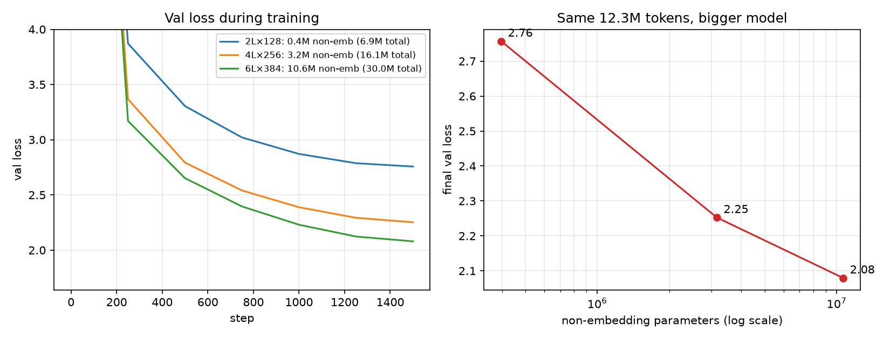

# Experiments (Milestone 5)

All runs: TinyStories, GPT-2 tokenizer, 1,500 steps × 8,192 tokens = **12.3M tokens**, same seed, data order,
and LR schedule (warmup 100 → cosine to 1e-4). Baseline = GPT-2 style, 6 layers × 384 wide (30M params), val **2.080**.
Predictions were written down **before** seeing results.

## A. Model size vs loss ✅

| Model | Non-emb params | Final val | Tokens / param |
|---|---|---|---|
| 2L × 128 | 0.40M | 2.757 | 31 |
| 4L × 256 | 3.16M | 2.252 | 3.9 |
| 6L × 384 | 10.65M | 2.080 | 1.2 |

**Takeaway:** loss falls roughly linearly in log(params), but with shrinking returns at a fixed token budget
(~0.56 per 10× → ~0.32 per 10×). The big model is data-starved (1.2 tokens/param vs Chinchilla's ~20).
Same model with 3.3× more tokens (the 41M-token run) reached **1.674**, a gain of 0.41, versus 0.17 from 3.4× more params.

## B. Pre-LN vs post-LN ⏳

**Prediction:** no meaningful change at 6 layers. Pre-LN's clean residual path (guards against vanishing gradients)
should matter more as depth grows.

| Variant | Final val | Δ vs baseline | tok/s |
|---|---|---|---|
| pre-LN (baseline) | 2.080 | — | |
| post-LN | | | |

## C. Modern upgrades, cumulative ⏳

**Predictions:**
- **RMSNorm:** no change in loss; maybe slightly faster.
- **RoPE:** learned positions may win at this scale (256 positions, all well trained); expect a tipping point
  in RoPE's favour at larger scale / longer context. Maybe slightly faster (no position table).
- **SwiGLU:** a very small improvement (gating gives finer control than GELU).

| Variant | Final val | Δ vs previous | tok/s |
|---|---|---|---|
| GPT-2 baseline | 2.080 | — | |
| + RMSNorm | | | |
| + RoPE | | | |
| + SwiGLU | | | |
