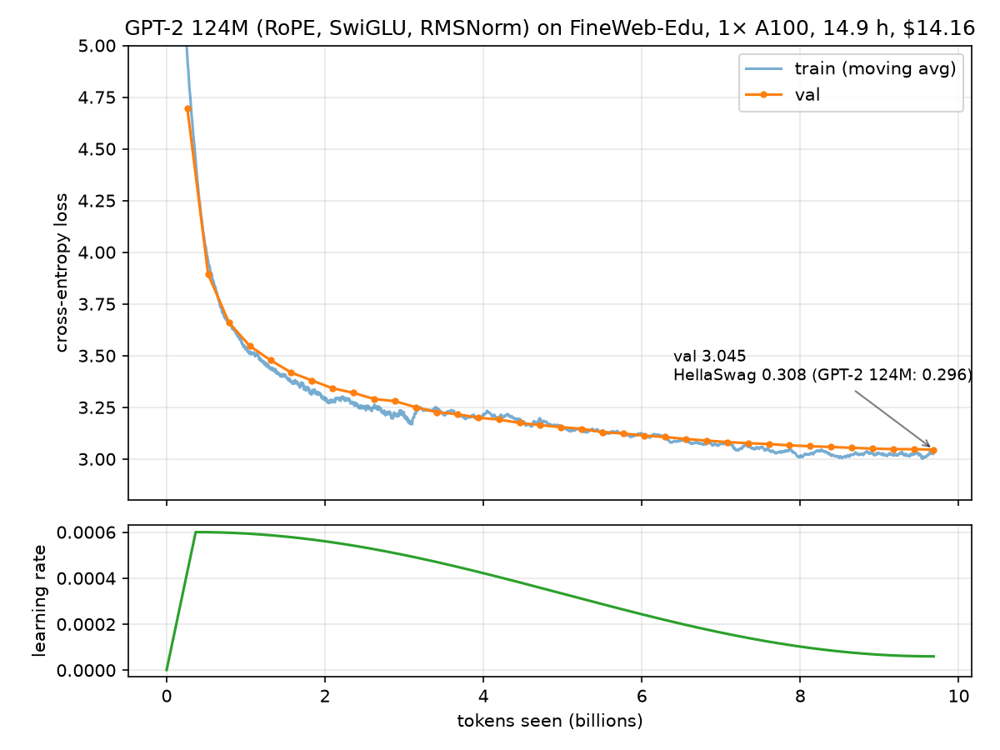

# toy-gpt2

A GPT-2 (124M) built from scratch in PyTorch and trained on a single rented A100 for **$14.16**.
It beats OpenAI's original GPT-2 124M on HellaSwag while training on roughly 10× fewer tokens.

| | This model | OpenAI GPT-2 124M |
|---|---|---|
| HellaSwag (acc_norm, 10,042 examples) | **0.308** | 0.296 |
| Training tokens | 9.7B (FineWeb-Edu) | ~100B (WebText, est.) |
| Hardware | 1× A100 80GB, 14.9 h | — |
| Cost | **$14.16** (incl. dry run) | — |
| Final val loss (FineWeb-Edu) | 3.045 | — |



## Samples

Temperature 0.8, top-k 50, unedited:

> **The French Revolution began in** 1789, after the French Revolution, and led to the establishment of the French Republic and the French Empire…

> **Photosynthesis is the process by which** plants use light energy from the sun, to grow. … Photosynthesis is an important process that plants use to obtain nutrients and oxygen.

> **The most important thing to know about** this bird is its size and habits. The male is brown with white on the back and black on the back. The young are black with a yellow-orange marking on the tail…

Fluent, on-topic textbook prose; facts are hit-and-miss and there's no reasoning or maths.
That's the 124M-parameter trade-off: fluency is cheap, knowledge is expensive.

## The model

A decoder-only transformer, GPT-2 small shape (12 layers, 12 heads, 768 wide, 1,024 context),
with the components chosen by my own ablations ([EXPERIMENTS.md](EXPERIMENTS.md)):

| Component | Choice | Why |
|---|---|---|
| Positions | **RoPE** | Biggest single win in my ablations (−0.10 val loss, more than tripling model size gave) |
| MLP | **SwiGLU** (hidden 2,048) | Small consistent gain; hidden size cut to keep params equal |
| Norm | **RMSNorm** | Same loss as LayerNorm, simpler |
| Norm position | **Pre-LN** | Post-LN actually won at 6 layers (−0.05), but pre-LN is the safe choice at 12+ layers |
| Embeddings | Tied input/output, vocab padded 50,257 → 50,304 | Saves 38.6M params; padding fits GPU tiles |
| Init | std 0.02, residual projections scaled by 1/√(2·layers) | Keeps the residual stream's variance flat with depth |

123.6M parameters. Model code: [`src/toy_gpt2/gpt.py`](src/toy_gpt2/gpt.py).

## Training

- **Data:** FineWeb-Edu, 10B-token sample, pre-tokenized with the GPT-2 tokenizer, read sequentially (every token seen once).
- **Optimizer:** AdamW (β 0.9/0.95, weight decay 0.1 on matrices only), grad clip 1.0, 524,288 tokens per step via gradient accumulation.
- **Schedule:** 700-step warmup to 6e-4, cosine decay to 6e-5.
- **Speed:** bf16 autocast, Flash attention (`scaled_dot_product_attention`), `torch.compile`, fused AdamW, TF32.
  **182k tokens/s, 50% MFU** on one A100.
- **Sized by time, not tokens:** the run measures its own seconds per step after ~70 steps and sets the
  schedule length to fit the budget ([SIZING.md](SIZING.md)). The budget was set *before* renting anything.
- **Ops:** resumable atomic checkpoints, a NaN guard, a 15-minute dry run on the real box first
  (it caught a resume bug), and a [runbook](RUNBOOK.md).

## How I got here

| Milestone | Result |
|---|---|
| 1. Bigram on Shakespeare characters | val 2.49 (the floor for one character of context) |
| 2. Byte-level BPE tokenizer, from scratch | 1.84 bytes/token at 512 merges vs GPT-2's 3.34 at 50k |
| 3. GPT from scratch, characters | val 1.66 |
| 4. Training loop, TinyStories, on a MacBook (M5) | 30M params, val 1.67, coherent short stories |
| 5. Architecture ablations | RoPE −0.10, post-LN −0.05, SwiGLU −0.007, RMSNorm ±0 |
| 6. Speed work, sizing, dry run | 182k tok/s, budgeted at $14.50 |
| 7. GPT-2 124M on a rented A100 | HellaSwag 0.308, $14.16 |

Notes on everything I learned along the way: [LEARNINGS.md](LEARNINGS.md).

## What I learned

- **Data quality beat scale.** ~10× fewer tokens than GPT-2, but educational web text instead of general web text.
- **Test your assumptions.** Two of my five predictions in the ablations were wrong, and those two (post-LN, RoPE) taught me the most.
- **Training is mostly memory-bound.** The big speed-ups (bf16, Flash attention, `torch.compile`) come from moving fewer bytes, not doing fewer FLOPs.
- **Adam doesn't care about gradient scale**, which is why clipping is a spike detector rather than a step-size control.
- **Measure before you spend.** Throughput first, then the budget, then a dry run on the real hardware.

## Reproduce

```bash
uv sync
uv run pytest -q                                      # 32 tests, CPU, a few seconds

# the full run, on a CUDA box (driver >= 580); see RUNBOOK.md
bash scripts/cloud_run.sh 15 99 gpt2                  # 15 h budget, 99 train shards

# with a checkpoint in runs/gpt2/
uv run python -m toy_gpt2.sample --run gpt2 --prompt "The French Revolution began in"
uv run python -m toy_gpt2.hellaswag --run gpt2
uv run python scripts/plot_gpt2.py
```

## Layout

```
src/toy_gpt2/
  gpt.py         model: attention, RoPE, SwiGLU, RMSNorm, generate
  train.py       training loop: grad accumulation, bf16, compile, DDP, time budget, checkpoints
  data.py        sequential shard loader
  hellaswag.py   HellaSwag eval (acc_norm)
  tokenizer.py   byte-level BPE from scratch (Milestone 2)
  eval.py        fixed eval harness used for the ablations
  sample.py      text generation from a checkpoint
scripts/         data download/prep, cloud launcher, plots
tests/           model shapes and param counts, resume equivalence, schedule
```

## How this was built

A learning project, coached by Claude (Anthropic). I wrote the tokenizer, the model and the original training loop;
Claude wrote most of the scale-up infrastructure (DDP, data pipeline, cloud scripts, HellaSwag), which I then walked through line by line.
The plan and milestones are in [PLAN.md](PLAN.md).
